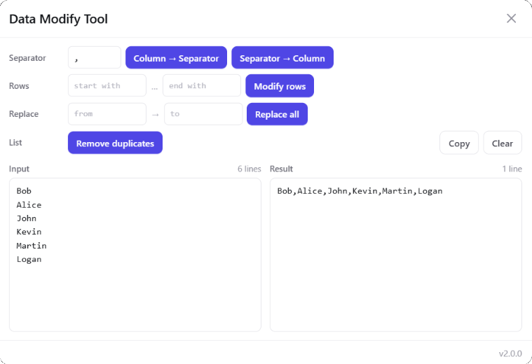

# Data Modify Tool

A text-wrangling scratchpad that runs as a **bookmarklet** (a browser bookmark holding JavaScript), so you can launch it on any page. Paste a column out of a spreadsheet, run one operation on it, and the result lands in the right-hand box and on your clipboard.

Everything happens locally in your browser. Nothing is sent anywhere, and nothing is stored - closing the panel discards both boxes.

<div align="center">
  
</div>

## Quick start

1. Open the [bookmarklet.js](dist/bookmarklet.js) file.
2. Copy the entire code (on GitHub use "Copy raw contents").
3. Create a new bookmark in your browser and paste the code as the URL.
4. Click the bookmark on any page.

## Operations

Each row pairs the fields an operation reads with the buttons that run it, so there is never a question of which input a button is about to use.

| Operation | Fields | What it does |
|---|---|---|
| **Column → Separator** | Separator | Joins every line with the separator. `a\nb\nc` with `,` becomes `a,b,c`. |
| **Separator → Column** | Separator | Splits on the separator and puts each piece on its own line. `a,b,c` becomes a three-row column. |
| **Modify rows** | Rows (start with, end with) | Adds text to the start and/or the end of every row. `'` and `',` turn a column of ids into `'123',` rows ready for a SQL `IN (...)`. |
| **Remove duplicates** | - | Drops repeated rows, keeping the first occurrence and the original order. |
| **Replace all** | Replace (from, to) | Replaces every occurrence of one string with another. Leave "to" empty to delete. |
| **Copy** | - | Puts the result on the clipboard again. |
| **Clear** | - | Empties both boxes. |

After every operation the result is copied to your clipboard automatically. The footer says whether the copy actually succeeded - if the page blocks clipboard access it says so rather than claiming otherwise.

**Copy** is there for when that automatic copy has been lost, which is easily done: any later `Ctrl+C` on the page overwrites the clipboard. It copies whatever is in the result box at the time, including edits made there by hand.

**Copy** and **Clear** are not transformations, so they sit at the far end of their row in the quiet button style rather than in the indigo of the five buttons that change the data. Both are disabled while there is nothing to act on.

## Behaviour worth knowing

**Empty lines are values.** A column copied out of Excel almost always ends with a newline, so `a\nb\n` joined by a comma gives `a,b,` - the trailing separator is real. Nothing is silently trimmed, because a row that vanishes between input and output is worse than a trailing comma you can see.

**Everything is literal text.** No field is treated as a regular expression. A `.`, `$`, `*` or `[` in the separator or the replace fields matches itself and nothing else. This is a change from the previous version, which built a `RegExp` out of your input:

- `$&`, `$1`, `` $` `` and `$'` typed into the "to" field were interpreted as substitution patterns, so replacing `a` with `$&$&` doubled the match instead of inserting the text;
- an empty "from" field matched at every position and wove the replacement between every character;
- an empty separator on **Separator → Column** exploded the input into one character per line.

The last two now refuse with a message in the footer instead of mangling the data.

**Duplicate removal compares whole rows**, exactly, case sensitively, whitespace included. Paste several columns and `a<tab>b<tab>c` only collapses against an identical `a<tab>b<tab>c`. If any column differs, it is not a duplicate. Excel is stricter in one way only: it can dedupe against one chosen column.

**Line endings** are normalised to `\n` on the way in, so data pasted out of a Windows editor behaves the same as anything else.

**Both boxes wrap long lines.** Each routinely holds one very long line - joining a column produces one, and splitting one back into a column starts from one - and unwrapped that line sits behind a horizontal scrollbar showing a few dozen characters at a time. Wrapping only takes effect on a line that does not already fit, so rows short enough to sit on one line are untouched and stay aligned. The line counts above each box count real lines, not wrapped ones, so a comma-joined result still reads `1 line` however many rows it covers on screen.

## State is not persisted

Both boxes live in memory only - no `localStorage`, no cookies, nothing in the bookmark URL. Closing the panel discards everything.

This is deliberate, and for the same reason as in [Random Picker](../random-picker): a bookmarklet's `localStorage` belongs to whichever page you happened to click the bookmark on, so anything saved would be there on one site and missing on the next. Rather than make persistence unreliable, there is none.

## Security

The attack surface is deliberately close to zero and is meant to stay that way.

Pasted data reaches the DOM **only** through `textarea.value`, never through `innerHTML`. Markup pasted into the tool stays text, which is covered by a test rather than by convention. The only `innerHTML` in the app writes the panel's own static skeleton.

Replacement and splitting use `String.split`/`join` rather than a `RegExp` assembled from user input, which removes the ReDoS surface along with the substitution bugs listed above.

Nothing leaves the browser. There is no network call anywhere in the bundle, and unlike the previous version there is no webfont request either - the panel inherits the host page's typeface.


## Host page isolation

The panel is injected into a page whose CSS it cannot predict, so `.mw-dmt *` resets the inheritable properties that would distort the data. `text-transform` is the dangerous one: a host page rule that uppercases text would change what you read back out of the result box, and this tool exists to move exact strings around.

`font-family` is deliberately **not** reset at the panel level - inheriting the host page's typeface is intentional. The textareas override it for themselves.

Host page rules marked `!important` will still win. Overriding those would mean marking every declaration `!important`, which is not worth the bundle size for a case real sites do not hit.

[`public/harness.html`](public/harness.html) is a manual test page carrying deliberately hostile host-page CSS (uppercase, letter spacing, forced borders, oversized SVGs, a high `z-index` overlay). Run `npm run build`, then `npm run dev`, and open `/harness.html` to check isolation against the real built bundle.

If the panel does not appear, check whether page elements have a higher `z-index` than the overlay (`1000000`) and panel (`1000001`). Adjust in [`_Tool.styles.scss`](src/components/_Tool.styles.scss).

## Development

- Works with Node `22.20.0`
- `npm i`
- `npm run dev` starts a Vite dev server with hot module reloading. After closing the panel, refresh the page to reopen it.

> `npm i` prints an `EBADENGINE` warning: jsdom 30 asks for Node `^22.22.2`. It is a test-only dependency and the suite passes on 22.20.0. Bump Node to silence it.

### Scripts

| Script | What it does |
|---|---|
| `npm run dev` | Start Vite dev server |
| `npm run build` | Type-check, lint, and produce `dist/bookmarklet.js` |
| `npm run check` | TypeScript and ESLint checks only |
| `npm run ts` | TypeScript check only (`tsc --noEmit`) |
| `npm run lint` | ESLint only |
| `npm run css` | Compile `styles.scss` to `styles.css` standalone (inspection only, not used by the build) |
| `npm test` | Run the unit test suite once |
| `npm run test:watch` | Run tests in watch mode |

### Structure

```
src/
├── app.ts                       Mounts the panel and wires buttons to operations
├── core/
│   ├── transforms.ts            Every operation as a pure string -> string function
│   └── clipboard.ts             Clipboard API with an execCommand fallback
├── components/
│   ├── ToolSkeleton.component.ts
│   ├── Header/                  Title and close
│   ├── Controls/                The four operation rows, plus Copy and Clear
│   └── Panes/                   Input and result boxes
└── styles/styles.scss           Imports every component partial
```

The split between `core/` and the rest is the point of the rewrite. In the previous version every operation read straight from the DOM and wrote straight back, so nothing could be tested without driving a panel. The transformations are now ordinary functions with no DOM, no clipboard and no state.

### Styles

SCSS partials live next to their components and are imported into [`src/styles/styles.scss`](src/styles/styles.scss), which Vite compiles and inlines via the `?inline` import in [`app.ts`](src/app.ts). No manual SCSS step is needed.

Import order matters: `_Tool.styles.scss` comes first so that its `.mw-dmt *` reset loses to the component rules that follow, which share its specificity.

### Tests

Vitest with jsdom. Files live in `src/__tests__/`:

```
src/__tests__/
├── setup.ts                  Clipboard and execCommand stubs, DOM cleanup
├── App.test.ts               Integration - mount, every operation, Copy, Clear, counts, close
└── core/
    ├── transforms.test.ts    Every operation as plain input/output pairs
    └── clipboard.test.ts     Clipboard API, execCommand fallback, honest failure reporting
```

`transforms.test.ts` is where the behaviour is pinned down, and it is written to be read: each case states what goes in and what should come out. `App.test.ts` covers the wiring - that the right button reads the right field and writes the right box.

### Build output

`npm run build` runs the checks and produces `dist/bookmarklet.js`, a single minified IIFE prefixed with `javascript:` on one line, ready to paste as a bookmark URL. The build fails on any TypeScript or lint error.

Around 14 KB, comfortably inside the roughly 64 KB limit Firefox imposes on `javascript:` bookmark URLs, so there is no separate Firefox build.

`scripts/wrap-bookmarklet.mjs` exists only to strip the newline Terser puts after its `javascript:` preamble, since a bookmark URL must be a single line.

### Versioning

Update the version in `package.json`. It is read at build time and shown in the panel footer.

## History

The tool started in June 2019 as a plain HTML/CSS/JS page and was published as a [Chrome Extension](https://chrome.google.com/webstore/detail/data-modify-tool/cogafmjhbnldmcigfgciljkeaifdljgm). Version 2.0.0 is a rewrite in TypeScript as a bookmarklet; see the changelog for what changed and why.
